<!-- ============ FULL-WIDTH SNAKE PORTRAIT ============ -->

<div align="center">
  
</div>

<br/>

<!-- ============ SYSTEM PROFILE ============ -->

## ⚡ System Profile

I'm a **Python Full-Stack Developer** who engineers complete digital products from the ground up — sleek, motion-driven frontends paired with fast, resilient backend APIs.

- 🔭 **Currently building:** Full-stack e-commerce architecture (**SoleX**) and AI-assisted web platforms
- 🧠 **Core architecture:** React + Redux Toolkit on the client; Python + FastAPI + PostgreSQL/Supabase on the server
- 🎨 **Design philosophy:** Pitch-black themes, micro-interactions, GSAP / Framer Motion, zero-bloat performance
- ⚡ **Motto:** `最後に勝つ` — *relentless execution until it ships.*

<br/>

<!-- ============ LIVE ENVIRONMENT ============ -->

## 🖥️ Live Environment

```yaml
user: abucodess
role: Python Full-Stack Developer
os: Windows 11 + WSL2 (Ubuntu)
editor: VS Code
architecture:
  frontend: [React, Redux Toolkit, Tailwind, Vite]
  motion: [GSAP, Framer Motion, Three.js, Lenis]
  backend: [Python, FastAPI, REST APIs]
  database: [PostgreSQL, Supabase]
  devops: [Docker, Git, GitHub Actions, Vercel]
status: "Shipping production code 🚀"
```

<br/>

<!-- ============ 8-BIT INTRO ============ -->

<div align="center">

  

  <a href="https://github.com/abucodess">
    
  </a>

  <br/><br/>

  <p align="center">
    <a href="mailto:abubackermax10@gmail.com">
      
    </a>
    <a href="#-flagship-projects">
      
    </a>
    
    <a href="https://github.com/abucodess?tab=followers">
      
    </a>
  </p>

  

</div>
