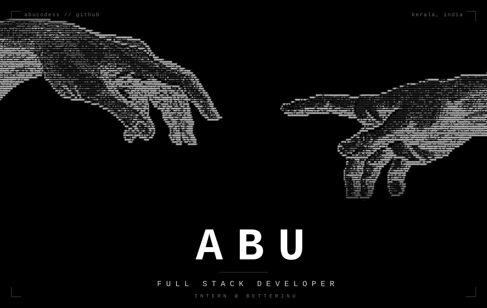
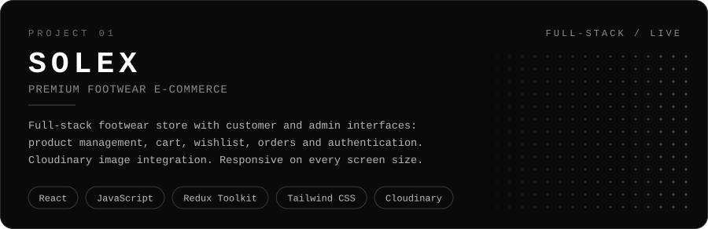
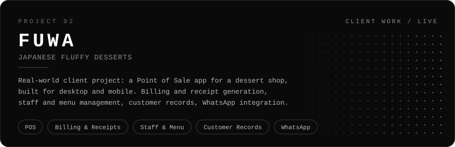
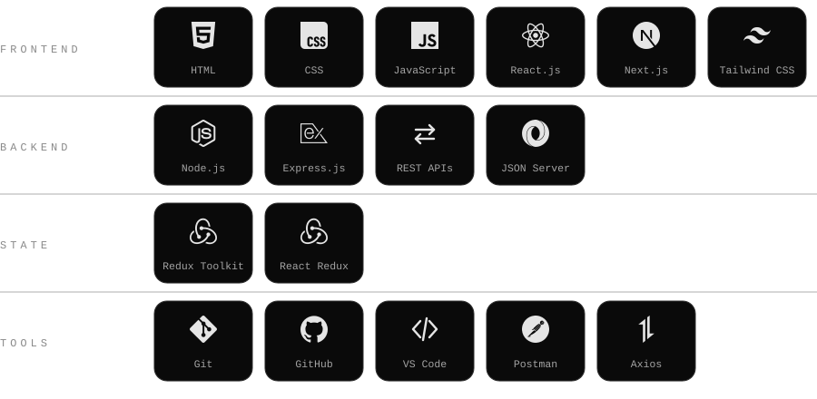

<div align="center">
  
  <br/><br/>
  <i>Practical skills. Real projects. Real experience.</i>
  <br/><br/>
</div>

<div align="center"></div>

I'm **Abu**, a full stack developer from Kerala, India. I build web applications with React, Next.js, Node.js and Express, and I learn by building real projects and gaining industry experience.

```text
role       Full Stack Developer Intern @ BetterInU
studying   BCA (online) @ Jain University
location   Kerala, India
stack      React · Next.js · Node.js · Express · Redux Toolkit
```

<div align="center"></div>

I left the traditional B.Tech path to take control of my own career: focus on practical skills, build real things, and get real industry experience.

```text
01  Left the traditional B.Tech path
02  Chose practical skills and learning by building
03  Built SOLEX, then FUWA for a real client
04  Started as a Full Stack Developer Intern at BetterInU
05  Studying BCA online at Jain University

→   Direction: Full Stack Developer
```

<div align="center"></div>

<div align="center">
  <a href="https://solex-ecommerce.vercel.app">
    
  </a>
  <br/>
  <a href="https://solex-ecommerce.vercel.app">Live site</a> &nbsp;·&nbsp; <a href="https://github.com/abucodess/Ecommerce-website-reactjs">Source code</a>
  <br/><br/>
  <a href="https://fuwa-japanese.vercel.app">
    
  </a>
  <br/>
  <a href="https://fuwa-japanese.vercel.app">Live site</a>
  <br/><br/>
</div>

<div align="center"></div>

<div align="center">
  
</div>

<div align="center"></div>

<div align="center">
  
  &nbsp;
  
  <br/><br/>
  
</div>

<div align="center"></div>

<div align="center">
  <a href="https://github.com/abucodess"></a>
  <a href="mailto:abubackermax10@gmail.com"></a>
  <br/><br/>
  
=======

<!-- ============ FULL-WIDTH SNAKE PORTRAIT ============ -->

