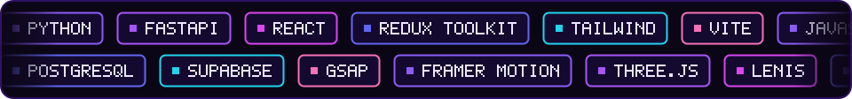

<table width="100%">
  <tr>
    <td width="40%" align="center" valign="middle">
      
    </td>
    <td width="60%" valign="top">

### ⚡ System Profile

I'm a **Python Full-Stack Developer** who engineers complete digital products from the ground up — sleek, motion-driven frontends paired with fast, resilient backend APIs.

- 🔭 **Currently building:** full-stack e-commerce architecture (**SoleX**) & AI-assisted web platforms
- 🧠 **Core architecture:** React + Redux Toolkit on the client; Python + FastAPI + PostgreSQL/Supabase on the server
- 🎨 **Design philosophy:** pitch-black themes, micro-interactions, GSAP / Framer motion, zero-bloat performance
- ⚡ **Motto:** `最後に勝つ` — *relentless execution until it ships.*

### 🖥️ Live Environment

```yaml
user: abucodess
role: Python Full-Stack Developer
os: Windows 11 + WSL2 (Ubuntu)
editor: VS Code
architecture:
  frontend: [React, Redux Toolkit, Tailwind, Vite]
  motion:   [GSAP, Framer Motion, Three.js, Lenis]
  backend:  [Python, FastAPI, REST APIs]
  database: [PostgreSQL, Supabase]
  devops:   [Docker, Git, GitHub Actions, Vercel]
status: "Shipping production code 🚀"
```

    </td>
  </tr>
</table>
<div align="center">

<!-- ============ 8-BIT INTRO: a pixel hero bumps ? blocks and the letters A-B-U pop out ============ -->


<a href="https://github.com/abucodess">
  
</a>

<br/><br/>

<p align="center">
  <a href="mailto:abubackermax10@gmail.com">
    
  </a>
  <a href="#-flagship-projects">
    
  </a>
  
  <a href="https://github.com/abucodess?tab=followers">
    
  </a>
</p>


</div>

<!-- ============ ABOUT: portrait drawn by the snake + profile ============ -->


<br/>

## 🧰 Tech Arsenal

<div align="center">



<br/>


</div>

<br/>

## 🚀 Flagship Projects

<table width="100%">
  <tr>
    <td width="33%" valign="top">

### 🛒 SoleX
Full-stack e-commerce architecture — a React + Redux Toolkit storefront on a FastAPI + PostgreSQL/Supabase backend.

  

<!-- ✏️ swap in the exact repo URL -->
[**View repo →**](https://github.com/abucodess/solex)

    </td>
    <td width="33%" valign="top">

### ☕ Mocha Counter POS
Café point-of-sale on Supabase — orders, products, categories and admin / staff roles.

 

<!-- ✏️ swap in the exact repo URL -->
[**View repo →**](https://github.com/abucodess/mocha-counter-pos)

    </td>
    <td width="33%" valign="top">

### 🔐 RBAC App
Role-based access control app — React, Redux and Vite on top of a json-server API.

 

<!-- ✏️ swap in the exact repo URL -->
[**View repo →**](https://github.com/abucodess/rbac-app)

    </td>
  </tr>
</table>

<br/>

## 📊 GitHub Telemetry

<div align="center">


</div>

<br/>

## 🐍 The Snake Eats My Commits

<div align="center">

<picture>
  <source media="(prefers-color-scheme: dark)" srcset="https://raw.githubusercontent.com/abucodess/abucodess/output/github-snake-dark.svg"/>
  <source media="(prefers-color-scheme: light)" srcset="https://raw.githubusercontent.com/abucodess/abucodess/output/github-snake.svg"/>
  
</picture>

</div>

<br/>

<div align="center">


</div>
